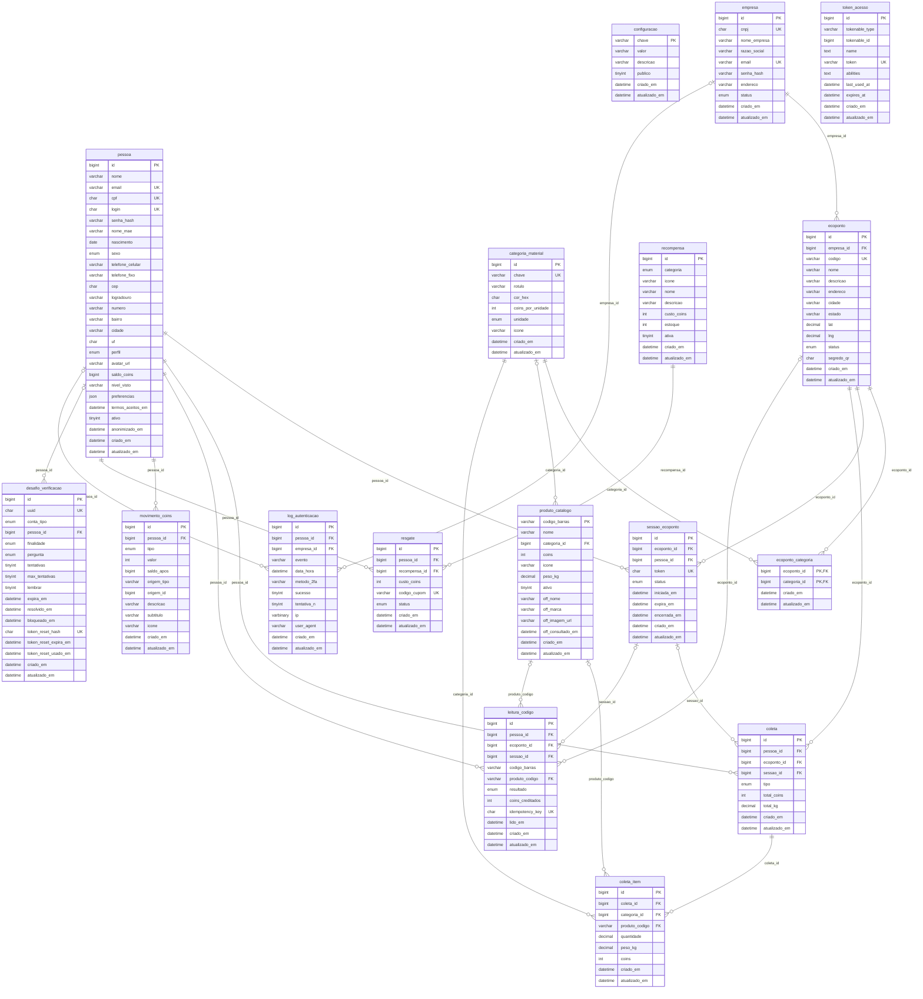

# DER — EcoTech

17 tabelas (snake_case, em português). Gerado a partir das migrations. Abra no GitHub ou em https://mermaid.live.

Relações que não são FK no banco: `token_acesso.tokenable_type/tokenable_id` aponta para `pessoa` ou `empresa` (morph do Sanctum); `movimento_coins.origem_tipo/origem_id` aponta para a coleta, leitura ou resgate que gerou o lançamento.
